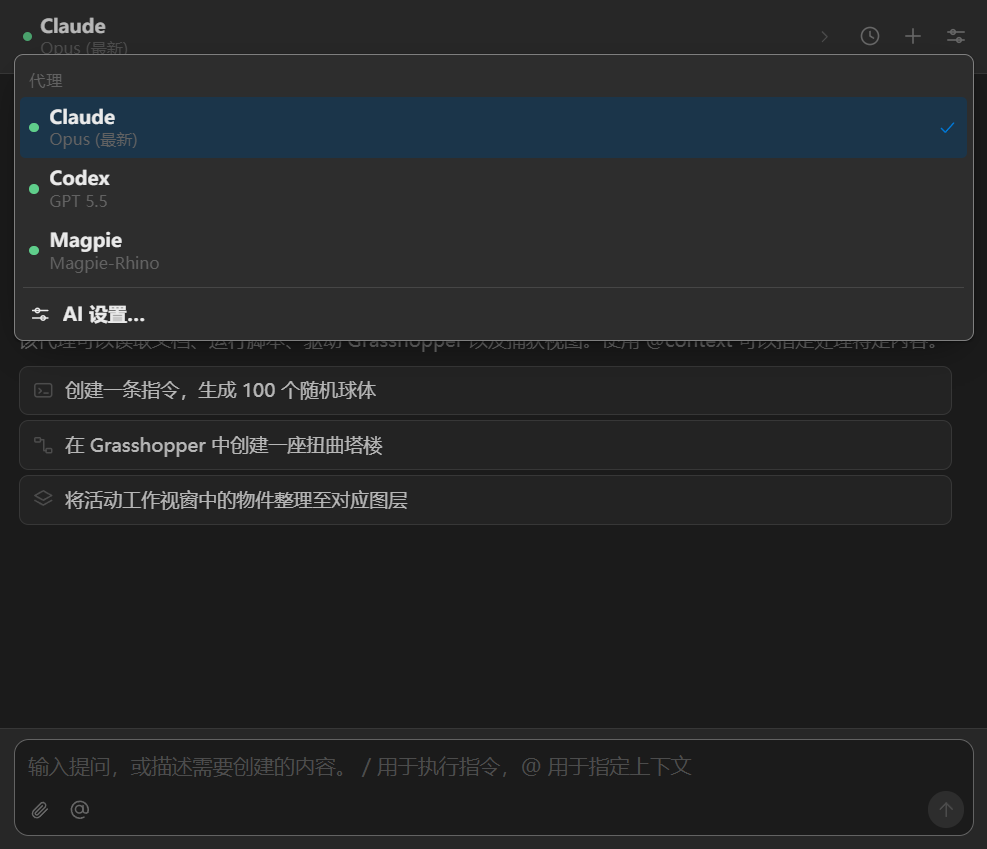

# Magpie-Rhino

Version 0.3.3 remembers YOLO mode and stabilizes scrolling while reading streamed details.
Magpie appears directly in Rhino's native AI agent menu.



A **Magpie** architectural modeling workspace for **Rhino 9 on Windows**, using your local
Magpie gateway, model groups and routing strategies.

```text
Rhino Magpie panel → selected Magpie model / group → tool calls → Rhino MCP → native geometry
```

The panel supports separate conversations per document, model and group selection,
tool approvals, cancellation, and viewport image feedback. Magpie owns model
routing and provider accounts. Rhino's installed AI plugin supplies the MCP tools.

The architectural workspace adds live streaming, a task plan with acceptance
conditions, drawing references, scale grounding, repair attempts and human review.
Architectural mode is enabled initially; direct editing remains available in settings.

## 安装和使用

1. 下载 Release 中的 `Magpie-Rhino-win-x64.zip` 并完整解压。
2. 安装其中的 `.yak` 包，或运行 `install-panel.ps1`。然后重启 Rhino 9。
   插件会在启动时自动创建检测目录，不改写已有模型和连接配置。
3. 在 Magpie 安装配套连接插件。市场审核期间可使用本机路径安装
   `magpie plugin add "完整路径/Magpie-Rhino"`。
4. 在 Magpie 的 Agent 页连接 **Magpie-Rhino**，选择模型、自定义组或策略。
5. 正常打开 Rhino 的 **AI 面板**，在代理菜单选择 **Magpie**，无需输入命令。
   `MagpieStandalone` 提供独立面板入口。
6. 输入建模要求，点击发送。`Enter` 发送，`Shift+Enter` 换行。默认会在执行修改前显示工具参数供确认。

面板默认选择 **跟随 Magpie 当前模型 / 自定义组**，每次发送重新读取连接配置。
点击刷新模型可读取 Magpie 的完整模型及组列表，也可在面板内临时选择。
列表会在面板启动时自动加载，打开下拉框时按需更新；下拉框底部显示路由组数量，
并提供刷新及失败重试提示。
自定义组和 `auto/...` 策略的 ID 原样传给 Magpie，路由由 Magpie 执行。

可开启 **YOLO 自动执行**，免逐次工具确认。选择会跨新对话、文档和 Rhino 重启保留，
底部显示当前为 YOLO 或逐次确认；可随时在设置中切回逐次确认。
设计提问和假设尺度的确认保持独立。
停止后会等待已发出的 Rhino 操作返回，
再结束本轮，继续之前请检查模型。切换或关闭文档会停止当前回合。
每轮修改由 Rhino 撤销记录包围，可使用 `Ctrl+Z`。
刷新模型会保留当前选择，刷新期间也可点击停止。提问窗口支持单选、多选和补充说明。

## Requirements

- Windows x64, Rhino 9 with its built-in RhinoAI plugin enabled, and Magpie.
- A Magpie model or routing group with tool-call support.
- A local HTTP Magpie gateway. The connection file must contain a gateway root
  URL without `/v1`.

The native AI compatibility adapter retains RhinoAI's original WebView and adds
**Magpie** to its agent menu automatically. Magpie hosts this workspace inside
the AI panel; returning to native mode restores its original interface and agents.
The adapter changes the live UI through Eto controls and a bounded page extension.
It does not replace RhinoAI files or add a formal backend runner to its internal
registry. It only attaches to the known `Rhino.AI.UI.AIPanel` WebView shape and
keeps hosts per document. Rhino updates require a compatibility check.

If that UI shape is unavailable, the `Magpie` command falls back to the separate
panel. `MagpieStandalone` opens that panel explicitly. The modeling agent runs
directly against Magpie in either host.

The earlier v0.1 launcher remains under `src/RhinoMagpie` as a legacy component.
Use the current panel package for the direct integration described here.

## Configuration and document scope

The product display name is **Magpie-Rhino**, including its marketplace listing,
Magpie Agent entry, Rhino plugin title and release archive. Technical IDs
`rhino9-ai` and `rhino-magpie` remain stable for existing settings and Yak upgrades.
The named `Magpie-Rhino` folder avoids a generic `plugin` label for local installs.

The Magpie descriptor manages only `model`, `baseUrl` and `apiKey` in
`~/.config/rhino9-magpie/settings.json`. Disconnect in Magpie restores those keys.
The file contains a local gateway credential. Keep it private.

The panel reuses the MCP endpoint belonging to the active document. Listener
lookup uses a read-only reflection call to the installed RhinoAI host because
that version exposes no public per-document port API. When unavailable, the
panel starts a document listener using Rhino's `MCPStart` command.
That listener remains available until the document or Rhino session closes.
Other processes on the same computer can use it to run Rhino tools and scripts.

Tool results and conversations stay in memory until the panel closes. Prompts,
relevant model state and viewport images requested by the agent pass through
Magpie to the selected provider. Model compatibility and modeling quality vary.
Inspect created geometry and review any script or file-write approval.

Execution-mode preferences are stored separately in
`~/.config/rhino9-magpie/panel-preferences.json`. This file contains no gateway
credential, and disconnecting the Magpie connection does not reset the preference.
Fresh profiles default to tool confirmation; enabling YOLO remembers that choice.

## Build and checks

```powershell
node --test tests/agent.test.mjs
dotnet run --project tests/Core.Tests -c Release
dotnet run --project tests/Agent.Tests -c Release
dotnet run --project tests/Workflow.Tests -c Release
dotnet build src/RhinoMagpie.Plugin -c Release
./scripts/build-panel.ps1 -YakPath "E:/WORK/Rhino9/System/Yak.exe"
```

Streaming-detail browser regressions run with Playwright 1.60.0:
`node --test tests/browser/panel-scroll.test.mjs`. Set `PANEL_SCROLL_PLAYWRIGHT`
to an existing Playwright package directory, or install that pinned package and
its Chromium browser. CI runs these checks before packaging.

The Yak builder can also be downloaded from the official McNeel CLI download
page. CI uses the pinned Windows x64 Yak 0.19.1 builder and produces the `.yak`,
installer ZIP and SHA-256 checksums. GitHub tags publish release artifacts.

## Distribution

Magpie marketplace submission is tracked in `magpie-community/plugins#868`.
Rhino PackageManager/Yak and Food4Rhino are separate distribution channels.
Their actual submission state is recorded in `docs/validation.md`.

MIT. Unofficial community integration by mikidaren.

## Workflow references

The design draws on the user's architectural workflow requirements and Reer's
public product/tool documentation. `reer-ide/rhino_mcp` has an MIT license; its
remote-service repository declares proprietary terms. This workspace's UI and
agent control are our implementation, with no proprietary Reer code included.
